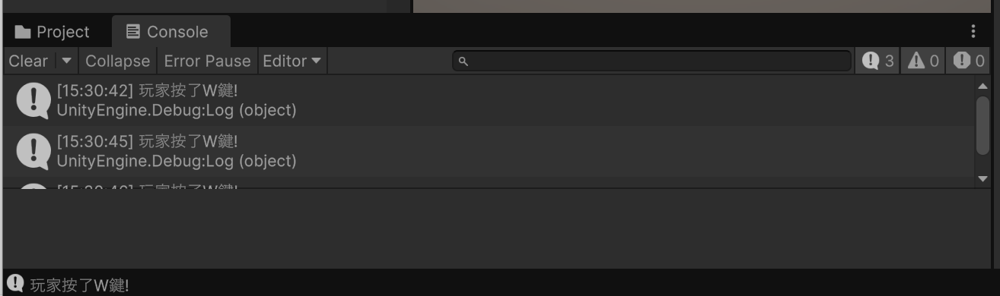
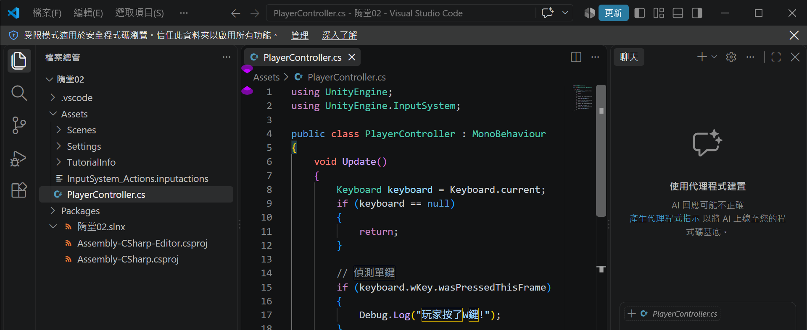
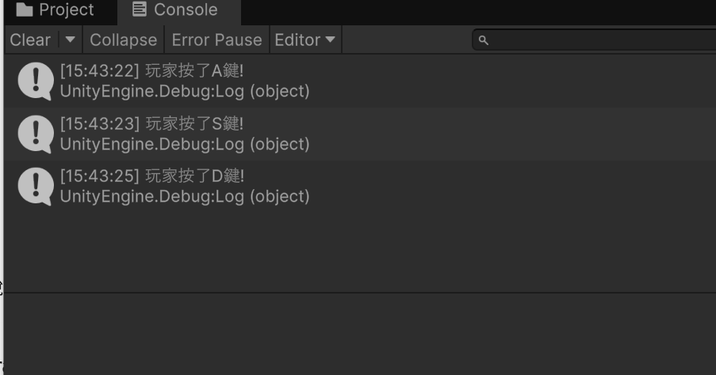
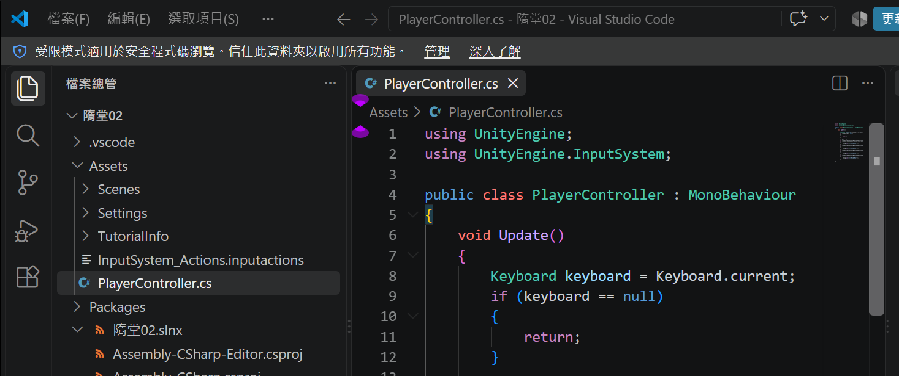
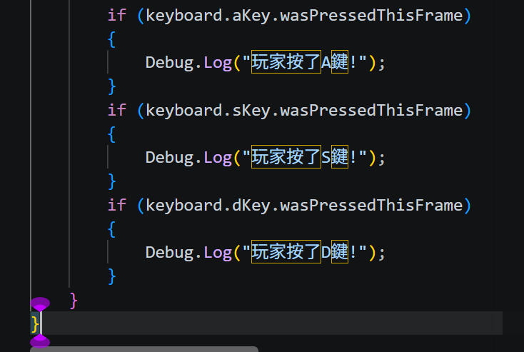

# 第2次練習題目-隨堂-QZ2

> 學號： 113111139 
> 姓名： 陳民輝 
> 作業撰寫時間： 180 mins 
> 最後撰寫文件日期： 2026/10/29

本份文件包含以下主題：(至少需下面兩項，若是有多者可以自行新增)

- [x] 說明內容
- [x] 其他 (可以包含心得或是想跟老師反映)

## 說明內容

PlayerController.cs 的 Update() 函式中建立即時鍵盤監聽機制：W 鍵偵測：透過 Keyboard.current.wKey 監控按鍵狀態，當偵測到玩家操作 W 鍵時，利用 Debug.Log 於 Unity Console 主控台輸出「玩家按了W鍵!」訊息。   A、S、D 鍵偵測：持續輪詢 A、S、D 鍵的輸入訊號，觸發時即時在 Console 印出對應提示（例如按下 A 鍵印出「玩家按了A鍵!」）。   下方將依序展示各按鍵之實作程式碼、Console 執行結果截圖與逐行程式碼解析。

### 1. (需截圖說明，並且需截圖執行結果)

Ans:

我先在 Unity 專案的 Assets 資料夾建立 `PlayerController.cs`，並在程式中引用 Unity 與新版輸入系統的命名空間。接著建立 `PlayerController` 類別，使用 `Update()` 持續檢查鍵盤輸入，再透過 `Keyboard.current` 取得鍵盤；如果沒有偵測到鍵盤，就先結束這次檢查。確認鍵盤存在後，我加入 W 鍵判斷，並在按下時使用 `Debug.Log` 顯示訊息。最後執行 Unity 專案並按下 W 鍵，確認 Console 有出現「玩家按了W鍵!」。

以下是各列程式碼的說明：

* **第 1 列 (`using UnityEngine;`)**：引入 Unity 引擎核心命名空間，提供 `MonoBehaviour`、`Debug` 等 Unity 基本類別與核心功能。
* **第 2 列 (`using UnityEngine.InputSystem;`)**：引入 Unity 新版輸入系統（New Input System）命名空間，讓腳本能夠存取 `Keyboard` 等新版輸入設備 API。
* **第 3 列**：空白行，用於區隔命名空間引用與類別主體，提升程式碼易讀性。
* **第 4 列 (`public class PlayerController : MonoBehaviour`)**：宣告名為 `PlayerController` 的公開類別，並繼承自 Unity 基底類別 `MonoBehaviour`，使其能以元件形式掛載於場景中的遊戲物件。
* **第 5 列 (`{`)**：`PlayerController` 類別本體的起始大括號。
* **第 6 列 (`void Update()`)**：宣告 Unity 生命週期函式 `Update`，在遊戲執行時每一個影格（Frame）都會被系統自動呼叫一次，用於即時且持續地偵測玩家輸入。
* **第 7 列 (`{`)**：`Update` 函式本體的起始大括號。
* **第 8 列 (`Keyboard keyboard = Keyboard.current;`)**：宣告 `Keyboard` 型別的區域變數 `keyboard`，並透過 `Keyboard.current` 取得目前電腦連接的主要實體鍵盤設備物件。
* **第 9 列 (`if (keyboard == null)`)**：安全防呆判斷式，檢查系統當前是否未偵測到任何實體鍵盤設備。
* **第 10 列 (`{`)**：防呆判斷區塊的起始大括號。
* **第 11 列 (`return;`)**：當無鍵盤連接時直接返回並結束本次 `Update` 執行，避免後續程式碼存取空物件而產生 `NullReferenceException` 錯誤。
* **第 12 列 (`}`)**：防呆判斷區塊的結束大括號。
* **第 13 列**：空白行，用以區隔防呆檢查與後續的按鍵邏輯。
* **第 14 列 (`// 偵測單鍵`)**：單行程式碼註解，標註下方邏輯功能為處理單一按鍵的觸發。
* **第 15 列 (`if (keyboard.wKey.wasPressedThisFrame)`)**：條件判斷式，檢查鍵盤上的 W 鍵是否剛好在當前影格被按下；使用 `wasPressedThisFrame` 能確保按下一瞬間只觸發一次，長按不會造成連續輸出。
* **第 16 列 (`{`)**：W 鍵觸發執行區塊的起始大括號。
* **第 17 列 (`Debug.Log("玩家按了W鍵!");`)**：當按下 W 鍵的條件成立時，於 Unity 編輯器的 Console（主控台）視窗印出指定文字訊息。
* **第 18 列 (`}`)**：W 鍵觸發執行區塊的結束大括號。

### 2. (需截圖說明，並且需截圖執行結果)

Ans:

第一題完成後，我沿用相同的鍵盤讀取方式，在 `Update()` 中再加入 A、S、D 鍵的判斷。每個按鍵都使用 `wasPressedThisFrame` 偵測按下當下，並設定對應的 `Debug.Log` 訊息。完成後執行 Unity 專案，依序按下 A、S、D 鍵，確認 Console 分別顯示玩家按下各按鍵的訊息。

第 1 列 (using UnityEngine;)：引入 Unity 核心命名空間，提供 MonoBehaviour、Debug 等 Unity 基本類別與核心功能。 
第 2 列 (using UnityEngine.InputSystem;)：引入 Unity 新版輸入系統（New Input System）命名空間，讓腳本能夠存取 Keyboard API。 
第 3 列：空白行，用於區隔命名空間引用與類別本體。 
第 4 列 (public class PlayerController : MonoBehaviour)：宣告名為 PlayerController 的公開類別，並繼承自 Unity 基底類別 MonoBehaviour，使其能以元件形式掛載於場景中的遊戲物件。 
第 5 列 ({)：PlayerController 類別本體的起始大括號。 
第 6 列 (void Update())：宣告 Unity 生命週期函式 Update，遊戲執行時每一影格（Frame）都會被系統自動呼叫一次，用於即時且持續地偵測玩家輸入。 
第 7 列 ({)：Update 函式本體的起始大括號。 
第 8 列 (Keyboard keyboard = Keyboard.current;)：宣告 Keyboard 型別變數，透過 Keyboard.current 取得目前電腦連接的主要實體鍵盤設備物件。 
第 9 列 (if (keyboard == null))：安全防呆判斷式，檢查系統當前是否未偵測到任何實體鍵盤設備。 
第 10 列 ({)：防呆判斷區塊的起始大括號。 
第 11 列 (return;)：若無鍵盤連接則立即中斷並退出本次 Update 執行，避免後續存取空物件引發 NullReferenceException 錯誤。 
第 12 列 (})：防呆判斷區塊的結束大括號。

## 其他

這堂課很讓人驚訝與驚奇,希望之後能學到更多東西# 第2次練習題目-隨堂-QZ2

> 學號： 113111139 
> 姓名： 陳民輝 
> 作業撰寫時間： 180 mins 
> 最後撰寫文件日期： 2026/10/29

本份文件包含以下主題：(至少需下面兩項，若是有多者可以自行新增)

- [x] 說明內容
- [x] 其他 (可以包含心得或是想跟老師反映)

## 說明內容
PlayerController.cs 的 Update() 函式中建立即時鍵盤監聽機制：W 鍵偵測：透過 Keyboard.current.wKey 監控按鍵狀態，當偵測到玩家操作 W 鍵時，利用 Debug.Log 於 Unity Console 主控台輸出「玩家按了W鍵!」訊息。   A、S、D 鍵偵測：持續輪詢 A、S、D 鍵的輸入訊號，觸發時即時在 Console 印出對應提示（例如按下 A 鍵印出「玩家按了A鍵!」）。   下方將依序展示各按鍵之實作程式碼、Console 執行結果截圖與逐行程式碼解析。

### 1. (需截圖說明，並且需截圖執行結果)

Ans:

我先在 Unity 專案的 Assets 資料夾建立 `PlayerController.cs`，並在程式中引用 Unity 與新版輸入系統的命名空間。接著建立 `PlayerController` 類別，使用 `Update()` 持續檢查鍵盤輸入，再透過 `Keyboard.current` 取得鍵盤；如果沒有偵測到鍵盤，就先結束這次檢查。確認鍵盤存在後，我加入 W 鍵判斷，並在按下時使用 `Debug.Log` 顯示訊息。最後執行 Unity 專案並按下 W 鍵，確認 Console 有出現「玩家按了W鍵!」。

以下是各列程式碼的說明：

* **第 1 列 (`using UnityEngine;`)**：引入 Unity 引擎核心命名空間，提供 `MonoBehaviour`、`Debug` 等 Unity 基本類別與核心功能。
* **第 2 列 (`using UnityEngine.InputSystem;`)**：引入 Unity 新版輸入系統（New Input System）命名空間，讓腳本能夠存取 `Keyboard` 等新版輸入設備 API。
* **第 3 列**：空白行，用於區隔命名空間引用與類別主體，提升程式碼易讀性。
* **第 4 列 (`public class PlayerController : MonoBehaviour`)**：宣告名為 `PlayerController` 的公開類別，並繼承自 Unity 基底類別 `MonoBehaviour`，使其能以元件形式掛載於場景中的遊戲物件。
* **第 5 列 (`{`)**：`PlayerController` 類別本體的起始大括號。
* **第 6 列 (`void Update()`)**：宣告 Unity 生命週期函式 `Update`，在遊戲執行時每一個影格（Frame）都會被系統自動呼叫一次，用於即時且持續地偵測玩家輸入。
* **第 7 列 (`{`)**：`Update` 函式本體的起始大括號。
* **第 8 列 (`Keyboard keyboard = Keyboard.current;`)**：宣告 `Keyboard` 型別的區域變數 `keyboard`，並透過 `Keyboard.current` 取得目前電腦連接的主要實體鍵盤設備物件。
* **第 9 列 (`if (keyboard == null)`)**：安全防呆判斷式，檢查系統當前是否未偵測到任何實體鍵盤設備。
* **第 10 列 (`{`)**：防呆判斷區塊的起始大括號。
* **第 11 列 (`return;`)**：當無鍵盤連接時直接返回並結束本次 `Update` 執行，避免後續程式碼存取空物件而產生 `NullReferenceException` 錯誤。
* **第 12 列 (`}`)**：防呆判斷區塊的結束大括號。
* **第 13 列**：空白行，用以區隔防呆檢查與後續的按鍵邏輯。
* **第 14 列 (`// 偵測單鍵`)**：單行程式碼註解，標註下方邏輯功能為處理單一按鍵的觸發。
* **第 15 列 (`if (keyboard.wKey.wasPressedThisFrame)`)**：條件判斷式，檢查鍵盤上的 W 鍵是否剛好在當前影格被按下；使用 `wasPressedThisFrame` 能確保按下一瞬間只觸發一次，長按不會造成連續輸出。
* **第 16 列 (`{`)**：W 鍵觸發執行區塊的起始大括號。
* **第 17 列 (`Debug.Log("玩家按了W鍵!");`)**：當按下 W 鍵的條件成立時，於 Unity 編輯器的 Console（主控台）視窗印出指定文字訊息。
* **第 18 列 (`}`)**：W 鍵觸發執行區塊的結束大括號。

### 2. (需截圖說明，並且需截圖執行結果)

Ans:

第一題完成後，我沿用相同的鍵盤讀取方式，在 `Update()` 中再加入 A、S、D 鍵的判斷。每個按鍵都使用 `wasPressedThisFrame` 偵測按下當下，並設定對應的 `Debug.Log` 訊息。完成後執行 Unity 專案，依序按下 A、S、D 鍵，確認 Console 分別顯示玩家按下各按鍵的訊息。

第 1 列 (using UnityEngine;)：引入 Unity 核心命名空間，提供 MonoBehaviour、Debug 等 Unity 基本類別與核心功能。 
第 2 列 (using UnityEngine.InputSystem;)：引入 Unity 新版輸入系統（New Input System）命名空間，讓腳本能夠存取 Keyboard API。 
第 3 列：空白行，用於區隔命名空間引用與類別本體。 
第 4 列 (public class PlayerController : MonoBehaviour)：宣告名為 PlayerController 的公開類別，並繼承自 Unity 基底類別 MonoBehaviour，使其能以元件形式掛載於場景中的遊戲物件。 
第 5 列 ({)：PlayerController 類別本體的起始大括號。 
第 6 列 (void Update())：宣告 Unity 生命週期函式 Update，遊戲執行時每一影格（Frame）都會被系統自動呼叫一次，用於即時且持續地偵測玩家輸入。 
第 7 列 ({)：Update 函式本體的起始大括號。 
第 8 列 (Keyboard keyboard = Keyboard.current;)：宣告 Keyboard 型別變數，透過 Keyboard.current 取得目前電腦連接的主要實體鍵盤設備物件。 
第 9 列 (if (keyboard == null))：安全防呆判斷式，檢查系統當前是否未偵測到任何實體鍵盤設備。 
第 10 列 ({)：防呆判斷區塊的起始大括號。 
第 11 列 (return;)：若無鍵盤連接則立即中斷並退出本次 Update 執行，避免後續存取空物件引發 NullReferenceException 錯誤。 
第 12 列 (})：防呆判斷區塊的結束大括號。

## 其他

這堂課很讓人驚訝與驚奇,希望之後能學到更多東西